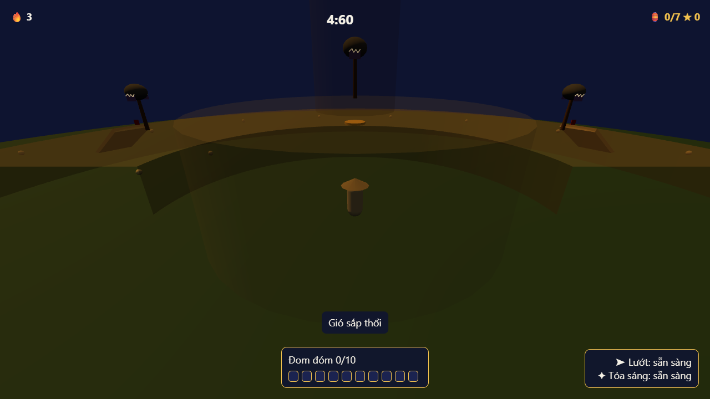

# Đảo Đèn Lồng

**Video demo (bản v1.0.1, 4 phút 10 giây):** [MP4 trên Release v1.0.1](https://github.com/Manny402/K5-L3A-DAY12-NguyenPhuNam-2A202603501-AI-SDLC-Dao-Den-Long/releases/download/v1.0.1/demo-v1.0.1.mp4) · [Bản đính kèm Release v1.0.0](https://github.com/Manny402/K5-L3A-DAY12-NguyenPhuNam-2A202603501-AI-SDLC-Dao-Den-Long/releases/download/v1.0.0/demo-v1.0.1.mp4) · [Google Drive](https://drive.google.com/file/d/19XsZF3DQc7n0diLJv_dHAAz0iO-BhHaK/view?usp=sharing)

Game 3D góc nhìn thứ ba gồm ba đêm. Điều khiển Mây nhặt đom đóm, giữ các Đèn Lồng Lớn sáng đến bình minh và tránh Bóng Mực, Gió Lạc. Bản mới nhất là `v1.0.1`; các tag `phase-1` đến `phase-4` lưu trạng thái từng checkpoint của lab.



## Yêu cầu và chạy game

- Node.js 20.18 trở lên; Chrome hoặc Edge có WebGL. Mã và dependencies JavaScript chạy trên Windows, macOS và Linux. Bản này đã được kiểm thử trên Windows; chưa xác nhận bằng máy macOS/Linux thực tế.
- Từ một bản clone sạch, chạy hai lệnh:

```bash
npm ci
npm start
```

Mở `http://localhost:8080`. Với ZIP đính kèm [Release v1.0.1](https://github.com/Manny402/K5-L3A-DAY12-NguyenPhuNam-2A202603501-AI-SDLC-Dao-Den-Long/releases/tag/v1.0.1), dependencies đã được đóng gói nên chỉ cần `npm start`. Dừng server bằng `Ctrl+C`.

## Điều khiển và luật chơi

| Phím | Hành động |
| --- | --- |
| `W` `A` `S` `D` | Di chuyển |
| `Space` | Nhảy |
| `Shift` | Lướt |
| `E` | Nạp đom đóm hoặc châm dầu cho đèn gần nhất |
| `Q` | Tỏa sáng, tốn 3 đom đóm |
| `P` hoặc `Esc` | Tạm dừng |

Có thể đổi phím, âm lượng, bảng màu, cỡ chữ trong **Cài đặt**. Đi gần đom đóm để tự nhặt. Đèn chưa từng sáng cần 10 đom đóm; đèn đã tắt sau khi từng sáng cần 5. Đèn sáng hao 1 dầu/giây và có thể châm dầu bằng `E`. Sức chứa ban đầu là 10, tăng 2 sau mỗi lần thắp thành công, tối đa 20.

| Đêm | Thời lượng | Số đèn cần sáng khi bình minh |
| --- | ---: | ---: |
| 1 — Đảo Bến | 240 giây | 3/5 |
| 2 — Đảo Cau | 270 giây | 4/6 |
| 3 — Đảo Chuông | 300 giây | 5/7 |

Hết 3 Ngọn Lửa sẽ thua ngay. Thắp đủ đèn không kết thúc đêm sớm. Điểm: +5 cho mỗi đom đóm nạp, +100 khi thắp đèn lần đầu, +40 khi thắp lại, +5 cho mỗi Bóng Mực trúng Tỏa Sáng (+15 nếu nó đang hút dầu). Khi thắng, cộng `50 + floor(dầu)` cho mỗi đèn đang sáng và +50 cho mỗi Ngọn Lửa còn lại. Tổng điểm chỉ gồm các đêm đã thắng.

## Kiểm chứng và chế độ headless

```bash
npm test
npm run test:ui
npm run headless -- --seed 42 --night 1 --ticks 600 --out out.jsonl
npm run bench -- --seed 42 --duration 30 --out bench.json
npm run soak -- --seed 7 --nights 10 --out soak.json
```

`test:ui` và benchmark cần Chrome hoặc Edge. Headless nhận thêm `--scenario scenario.json`, `--inputs inputs.json` và `--snapshot-every 10`; chạy logic cố định 60 tick/giây, ghi snapshot, event và end dưới dạng JSONL. Lệnh và thông số chuẩn nằm trong [game.contract.json](game.contract.json). Benchmark mở cửa sổ 1280×720, tắt VSync bằng cờ Chromium, khởi động 3 giây rồi đo đúng 30 giây. Vì đây là bản web, `peak_mem_mb` được ghi `null`.

Trên máy Windows dùng để phát triển, bản `v1.0.1` đạt 18 test, benchmark trung bình 245,77 FPS và soak 10 đêm không crash. Đây là kết quả máy cục bộ; [bằng chứng và ảnh](docs/proof/phase4-followup.json) nằm trong `docs/proof/`.

## Bảng xếp hạng, mã nguồn và phát hành

Sau khi thua hoặc thắng Đêm 3, nhập tên 3–12 ký tự `[A-Za-z0-9_]` để lưu điểm. Bảng top 10 lưu tại `~/.dao-den-long/leaderboard.json` và mở được từ menu. Xuất JSON bằng:

```bash
npm start -- --export-leaderboard out.json
```

`src/` chứa mô phỏng, server, headless, benchmark và soak; `public/` chứa game WebGL; `tests/` chứa kiểm chứng; `docs/notes/` ghi quyết định thiết kế, `docs/proof/` lưu bằng chứng. Xem [CHANGELOG.md](CHANGELOG.md), [CREDITS.md](CREDITS.md) và [LICENSE](LICENSE).

## Sáng tạo của tôi

Nhạc nền đêm và hiệu ứng âm thanh được tổng hợp bằng Web Audio; cảnh đảo, nón của Mây và giấy đèn rách được tạo bằng hình học, không dùng asset tải về. Các chi tiết này không thêm thực thể vào chế độ headless; bộ kiểm tra và benchmark của từng phase vẫn được giữ trong repo.
